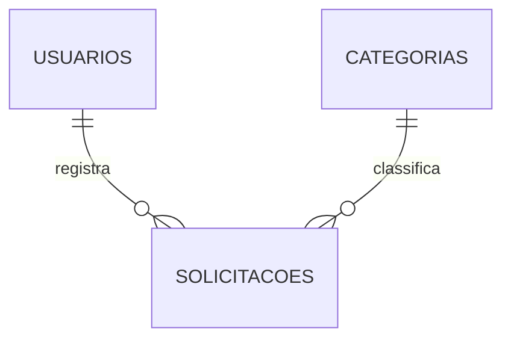

# Bairro em Dia

## Integrante

Joao Vitor Valaitis Paulo RM:576724

## Pitch

Link a adicionar após a gravação.

## Como executar

Requisitos: JDK 21 e Maven 3.9 ou superior.

```bash
mvn clean package
java -jar target/bairro-em-dia-1.0.0.jar
```

Swagger: http://localhost:8080/swagger-ui.html

O perfil local usa H2 em arquivo, com os dados armazenados em `data/`.

## Usuários de teste

| Papel | E-mail | Senha local |
|---|---|---|
| GESTOR | gestor@bairro.test | GestorDemo123! |
| CIDADAO | cidadao@bairro.test | CidadaoDemo123! |

Faça login em `POST /api/auth/login` e informe o `accessToken` em **Authorize** no Swagger.

## Diagrama das entidades



Cada solicitação possui um autor e uma categoria obrigatórios, com `ManyToOne`, `LAZY` e chaves estrangeiras. Não há remoção em cascata: excluir uma solicitação preserva o usuário e a categoria.

## Justificativa das consultas

| Tipo | Uso e justificativa |
|---|---|
| Query method | `findByEmail` localiza o usuário no login; `countByCidadaoIdAndStatus` realiza contagens por cidadão e status; `existsByCategoriaId` verifica vínculos antes de excluir uma categoria. |
| JPQL | `contarPorStatus` agrupa as solicitações por status, com filtro opcional de autor, para gerar o resumo. |
| Specification | Combina filtros de autor, categoria, status e título, com paginação e ordenação, sem criar uma consulta para cada combinação. |

